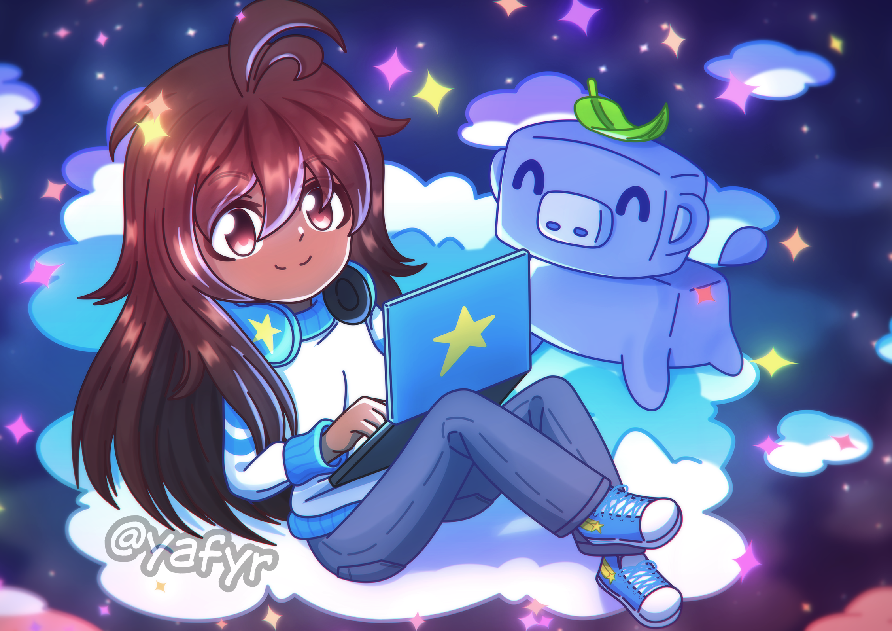

<h1 align="center">✨ Loritta Morenitta ✨</h1>

> [!IMPORTANT]
> We've decided to change Loritta to be closed source, sorry! The reason why we did this is because Loritta was not getting anything "back" from her being open source (users contributing to the project, community formed around Loritta's code and not just Loritta herself, etc), while having all the negatives of being open source (users complaining about self-hosting, users trying to steal Loritta's code without actually giving back to the open source community, etc), here's a more through explanation about why this was done: <https://mrpowergamerbr.com/blog/2026-05-23-open-source-to-closed-source>

All Discord servers have the same issues. Members want entertainment, moderators want automation... and you just want to rest.

Your life is too precious to spend your time with useless junk, let me take care of the boring parts while you have fun on your server!

With features to entertain and engage your members, moderation features to keep your server always safe and enjoyable, and with an easy way to set up but with an unmatched power of customization...

And everything thanks to a 16 year old girl trying to make the world a better place!

_Making your server unique and extraordinary has never been easier!_

## 🤔 How can I add her?

If you want to use Loritta on your server without messing around with hosting stuff, you can add our public instance by [clicking here](https://l.lori.fun/add-lori)! We recommend using the public instance, after all, more than 1 million guilds already use, trust and love her, so why not try it out?

___

